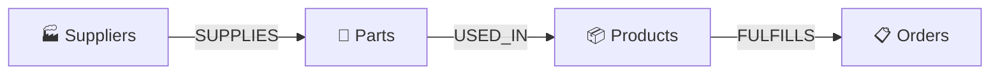
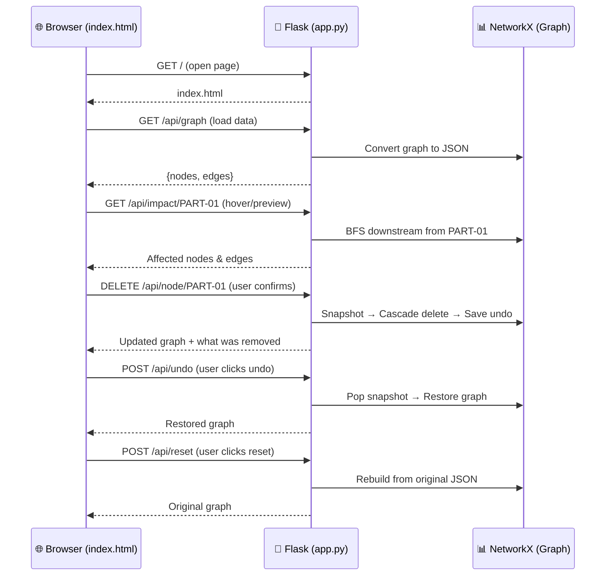

# `app.py` — Explained in Simple Words

This file is the **brain of the application**. It does two things:
1. **Builds a supply-chain graph** (a network of connected things) in memory
2. **Runs a web server** that lets the front-end webpage talk to it

Let's walk through it section by section.

---

## 1. The Imports (Lines 17–20)

```python
import json, copy, pathlib, time
from flask import Flask, jsonify, request, send_from_directory
import networkx as nx
```

Think of these as **tools the app picks up before starting work**:

| Import | What it does (in plain English) |
|---|---|
| `json` | Reads the `.json` data file (like reading a spreadsheet) |
| `copy` | Makes deep copies of the graph (like photocopying a document so the original stays safe) |
| `pathlib` | Finds file paths on your computer |
| `time` | Measures how long operations take (like a stopwatch) |
| `flask` | The **web server framework** — it receives requests from the browser and sends back responses |
| `networkx` (as `nx`) | The **graph library** — it knows how to build networks of connected nodes and traverse them |

---

## 2. Setting Up Paths & Flask (Lines 25–31)

```python
BASE_DIR = pathlib.Path(__file__).resolve().parent
DATA_FILE = BASE_DIR / "photon_sprint1_graph_data.json"
app = Flask(__name__, static_folder="static", static_url_path="/static")
```

- **`BASE_DIR`** → "Where is this `app.py` file located on the computer?"
- **`DATA_FILE`** → "The JSON data file is right next to me in the same folder"
- **`app = Flask(...)`** → "Create a web server. Also, there's a `static/` folder with the webpage inside it"

---

## 3. Loading the Data (Lines 37–42)

```python
def _load_raw_data() -> dict:
    with open(DATA_FILE, encoding="utf-8") as f:
        return json.load(f)

RAW = _load_raw_data()
```

**In simple words:** Open the JSON file, read everything inside it, and store it in a variable called `RAW`. This happens **once** when the server starts. `RAW` never changes — it's the **original master copy** of the data.

---

## 4. Building the Graph (Lines 45–63)

```python
def _build_graph(raw: dict) -> nx.DiGraph:
    G = nx.DiGraph()

    for category in ("suppliers", "parts", "products", "orders"):
        for node in raw["nodes"][category]:
            G.add_node(node["id"], **node)

    for edge_type in ("supplies", "used_in", "fulfills"):
        for edge in raw["edges"][edge_type]:
            G.add_edge(edge["source"], edge["target"], ...)

    return G
```

**In simple words:** This builds the **network diagram** from the JSON data.

Imagine you have a whiteboard:
1. **First loop** → You stick 19 sticky notes on it (one for each supplier, part, product, and order). Each sticky note has a unique ID like `SUP-01` or `PART-03`.
2. **Second loop** → You draw 21 arrows between the sticky notes:
   - `SUP-01` **→ supplies →** `PART-01`
   - `PART-01` **→ used in →** `PROD-01`
   - `PROD-01` **→ fulfills →** `ORD-01`

The result is a **directed graph** — arrows only go one way (left to right: supplier → part → product → order).



---

## 5. The Live Graph & Undo Stack (Lines 67–68)

```python
GRAPH: nx.DiGraph = _build_graph(RAW)
UNDO_STACK: list[dict] = []
```

- **`GRAPH`** → This is the **working copy** of the graph. When you delete nodes, this is what changes.
- **`UNDO_STACK`** → This is like a **stack of saved snapshots**. Every time you delete something, the app takes a "photo" of the graph *before* the deletion and pushes it onto this stack. When you hit Undo, it pops the latest photo and restores it.

> Think of it like Ctrl+Z in a text editor — it remembers previous states so you can go back.

---

## 6. Helper Functions (Lines 71–105)

### `_graph_to_json(G)` — Convert graph to JSON for the browser

```
Takes the graph → spits out a simple {"nodes": [...], "edges": [...]} dictionary
```

The browser doesn't understand NetworkX objects, so this **translates** the graph into plain JSON that D3.js can draw.

### `_downstream(G, start)` — "What depends on this node?"

```
Given a starting node → finds ALL nodes reachable by following arrows forward
```

Example: If you ask "what's downstream of `SUP-01`?", it follows arrows from `SUP-01` → finds `PART-01`, `PART-02`, `PART-05` → then follows those arrows → finds `PROD-01` → follows those → finds `ORD-01` through `ORD-06`. It uses **BFS** (Breadth-First Search) — like ripples spreading from a stone dropped in water.

### `_snapshot()` — Take a photo of the current graph

```
Deep-copies every node and every edge → returns the copy
```

This is the "save state" function. It makes a **completely independent copy** so that modifying the real graph later doesn't affect the saved version.

### `_restore(snap)` — Load a saved photo

```
Clears the current graph → rebuilds it from the snapshot
```

This is the "load state" function — the opposite of `_snapshot()`.

---

## 7. The API Routes (Lines 110–278)

These are the **URLs the browser can call** to interact with the graph. Think of them as buttons on a remote control:

---

### 🏠 `GET /` — Serve the webpage

```python
@app.route("/")
def index():
    return send_from_directory(BASE_DIR / "static", "index.html")
```

**What it does:** When you open `http://localhost:5000/` in your browser, it sends back the `index.html` file (the interactive graph page).

---

### 📊 `GET /api/graph` — Get the full graph

```python
@app.route("/api/graph")
def api_graph():
    return jsonify(_graph_to_json(GRAPH))
```

**What it does:** Returns **all** nodes and edges as JSON. The front-end calls this when the page first loads to draw the entire graph.

**Example response (simplified):**
```json
{
  "nodes": [{"id": "SUP-01", "kind": "supplier", "label": "Apex Components"}, ...],
  "edges": [{"source": "SUP-01", "target": "PART-01", "relation": "SUPPLIES"}, ...]
}
```

---

### 🔍 `GET /api/downstream/<node_id>` — Trace dependencies

```python
@app.route("/api/downstream/<node_id>")
def api_downstream(node_id):
    reachable = _downstream(GRAPH, node_id)
    return jsonify({"root": node_id, "downstream": list(reachable)})
```

**What it does:** "If I pick this one node, what other nodes depend on it (directly or indirectly)?"

**Example:** `GET /api/downstream/SUP-01` → returns all parts, products, and orders that would be affected if Supplier `SUP-01` disappeared.

---

### ⚠️ `GET /api/impact/<node_id>` — Preview deletion impact

```python
@app.route("/api/impact/<node_id>")
def api_impact(node_id):
    ...
```

**What it does:** "**What would happen IF** I deleted this node?" — without actually deleting anything. It's a **preview/dry-run**.

**Returns:**
- The node's details
- All its incoming and outgoing connections
- Every downstream node that would be removed in a cascade
- Every edge that would be removed
- Total count of affected nodes and edges
- Time complexity: O(V + E)

**Example:** Before deleting `PART-01`, the front-end calls this to show the user: "Deleting this will also remove PROD-01 and 6 orders. Are you sure?"

---

### 🗑️ `DELETE /api/node/<node_id>` — Delete a node (with cascade)

```python
@app.route("/api/node/<node_id>", methods=["DELETE"])
def api_delete_node(node_id):
    ...
```

**What it does (step by step):**

1. ⏱️ **Starts a stopwatch** (`time.perf_counter()`)
2. 📸 **Takes a snapshot** of the current graph (for undo)
3. 🔍 **Finds all downstream nodes** (everything that depends on this node)
4. 🗑️ **Removes them all** from the graph (cascade delete)
5. ⏱️ **Stops the stopwatch** and records how many milliseconds it took
6. 💾 **Saves the snapshot** to the undo stack (with metadata about what was deleted)
7. 📤 **Returns** the updated graph + details of what was removed + timing + complexity info

**Example:** `DELETE /api/node/PART-05` → Removes the Wiring Harness part, and since PROD-01 needs it, also removes PROD-01 and all 6 orders that PROD-01 fulfills. The response tells you exactly what was removed and how long it took.

---

### ↩️ `POST /api/undo` — Undo the last delete

```python
@app.route("/api/undo", methods=["POST"])
def api_undo():
    ...
```

**What it does:**
1. Checks if there's anything to undo (is the stack empty?)
2. **Pops the most recent snapshot** off the undo stack
3. **Restores the graph** to that snapshot
4. Returns the restored graph + info about what was brought back

**In simple words:** It's Ctrl+Z. Whatever you deleted last comes back, along with all its connections.

---

### 🔄 `POST /api/reset` — Reset everything

```python
@app.route("/api/reset", methods=["POST"])
def api_reset():
    global GRAPH
    UNDO_STACK.clear()
    GRAPH = _build_graph(RAW)
    return jsonify({"graph": _graph_to_json(GRAPH), "node_count": GRAPH.number_of_nodes()})
```

**What it does:** 
1. **Clears the entire undo history**
2. **Rebuilds the graph from scratch** using the original `RAW` data
3. Returns the fresh graph

**In simple words:** It's a factory reset. No matter how many things you deleted, this brings everything back to the original state.

---

## 8. Starting the Server (Lines 282–283)

```python
if __name__ == "__main__":
    app.run(debug=True, port=5000)
```

**What it does:** When you run `python app.py`, this starts the Flask web server on `http://localhost:5000`. The `debug=True` means it auto-reloads when you edit the code and shows detailed error messages.

---

## Summary: The Big Picture



**TL;DR:** `app.py` is a Flask web server that holds a supply-chain graph in memory. The browser asks it questions ("show me the graph", "what happens if I delete this?", "delete it", "undo that", "start over"), and it answers with JSON. It uses NetworkX for all the graph logic (building, traversing, deleting) and keeps an undo stack of snapshots so you can reverse deletions.
